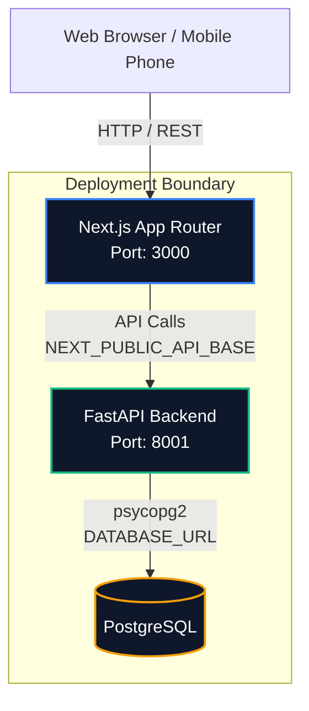
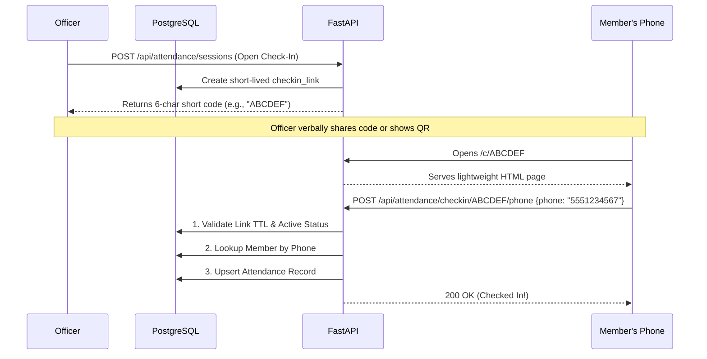
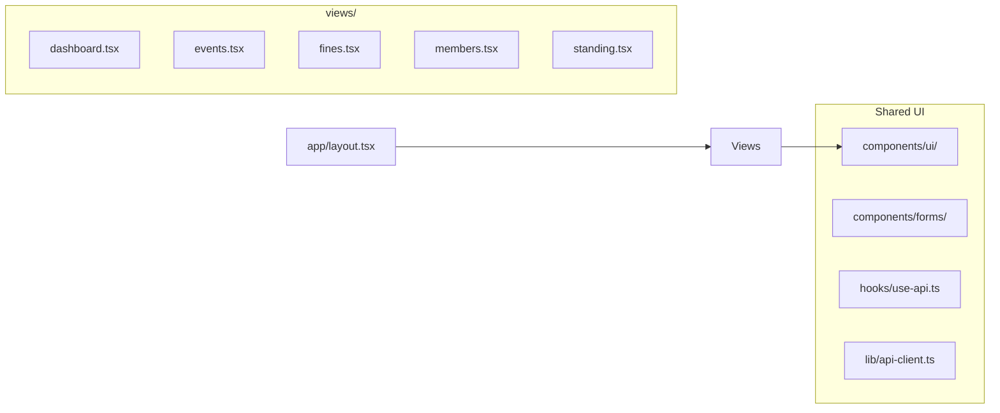

# GuildOS System Architecture

Last updated: 2026-06-12

This document provides a high-level overview of the FraternityOS (GuildOS) architecture. For treasury-specific details, see [TREASURY_ARCHITECTURE.md](TREASURY_ARCHITECTURE.md).

---

## 1. System Overview

GuildOS is a monolithic Next.js and FastAPI application backed by PostgreSQL.



### Layer Responsibilities

| Layer | Technology | Responsibilities |
|-------|------------|------------------|
| **Frontend** | Next.js 16, React 19, Tailwind/CSS | UI shell, dashboard views, short-link check-in forms. |
| **Backend** | Python, FastAPI | Business logic, authentication, CRUD operations, cron jobs. |
| **Database** | PostgreSQL | Persistence, atomic multi-row mutations via plpgsql RPCs, audit logging. |

---

## 2. Phone Check-In Architecture (No-Auth Flow)

One of the core features is the frictionless, zero-login phone check-in for members attending events.



---

## 3. Backend Module Structure

The backend is migrating towards a **Domain-Driven Design (DDD)** pattern, where each domain has its own independent router, services, and schemas.

```mermaid
graph TD
    API[api/index.py (App Factory)] --> Auth[api/auth/]
    API --> Treasury[api/treasury/]
    API --> RBAC[api/rbac/]
    API --> Operations[api/routes/operations.py]
    API --> Events[api/events/]
    
    subgraph Canonical Domain Shape [e.g. api/treasury/]
        Router[router.py]
        Services[services/]
        Schemas[schemas.py]
        Core[core/]
        DB_Helpers[db/]
    end
    
    Treasury --> Canonical Domain Shape
```

### Key Architectural Rules for Backend Services

1. **Isolation**: A domain (like `api/treasury/`) should not import schemas or logic from another domain directly if it can be avoided. Seams should use clear public interfaces.
2. **RPC Mutations**: Multi-row writes must be handled via PostgreSQL RPCs (`call_rpc`) to ensure atomic rollbacks and proper `audit_logs` tracking.
3. **Tenant Integrity**: Every tenant table carries `chapter_id`. Requests resolve `chapter_id` from the authenticated user token, *never* from the client payload.

---

## 4. Frontend Structure (`fratos/`)

The frontend uses Next.js App Router but keeps most logic abstracted in hooks and typed API clients.



---

## 5. Security & Auth Flow

1. **JWT Auth**: Officers/Members log in via `POST /api/auth/login`. The server returns an HS256 JWT containing `sub=member.id`.
2. **RBAC Guard**: The `api/rbac` module verifies permissions. API endpoints use `require_permission("domain:action")`.
3. **Service Role DB**: The API uses a service-role PostgreSQL client. Row-Level Security (RLS) is present but bypassed by the backend; instead, backend routes strictly filter by the token's `chapter_id`.

```mermaid
flowchart LR
    Request[HTTP Request + JWT] --> AuthDep[FastAPI Dependency: get_current_user]
    AuthDep --> Token[Decode JWT -> member_id, chapter_id]
    Token --> PermCheck[has_permission(member_id, 'action')]
    PermCheck -->|Allowed| Handler[Execute Route Handler]
    PermCheck -->|Denied| 403[403 Forbidden]
```
