# GuildOS (FraternityOS) Documentation Hub

Welcome to the GuildOS documentation! This folder contains all the reference material needed for developers and AI agents to continue building and maintaining the project.

## 🧭 Navigation

**Start here**

*   [Code map](CODEMAP.md) - Guided file order for agents (which files to open first).
*   [Architecture Overview](ARCHITECTURE.md) - System architecture, tech stack, and network flows.
*   [Services Design](services/README.md) - The canonical domain-package pattern for all backend services.
*   [Service Map](services/service-map.md) - Route ownership and the cross-domain seams.
*   [Permissions & RBAC](services/permissions-matrix.md) - Roles x permissions matrix.

**Deep dives**

*   [Database](DATABASE.md) - Schema conventions, migrations, RLS.
*   [Treasury Architecture](TREASURY_ARCHITECTURE.md) - The ledger, invoicing, and balance engine.
*   [Events V1 spec](events-v1-spec.md) + [phase status](events-dev-status.md) - Events, jobs, notify gate, initiatives.
*   [Ops runbook](ops-runbook.md) - Deploys, cron, outbox drain, incident steps.
*   [Features](FEATURES.md) - What ships today, by module.

**Product and process**

*   [MVP Operating Loop](services/mvp-operating-loop.md) - The weekly chapter cycle the software supports.
*   [Future Agents](services/future-agents.md) - Design constraints and hooks for future AI agents.
*   [ADRs](../../docs/adr/) - Decisions that are settled; don't relitigate them here.
*   [Archive](archive/README.md) - Shipped `imp-*.md` plans, kept for history only.

Live `imp-*.md` plans sit in this directory; once their work ships they move to
`archive/`.

## 🚀 Quick Start for Developers & Agents

If you are a new developer or agent jumping into the codebase, here is how the repository is structured:

```mermaid
graph LR
    A[GuildOS Repo Root] --> B(LocalDev)
    B --> C[api/]
    B --> D[fratos/]
    B --> E[migrations/]
    B --> F[tests/]
    B --> G[docs/]
    
    style B fill:#2a2a45,stroke:#6c5ce7,stroke-width:2px
    style C fill:#1a1a2e,stroke:#444
    style D fill:#1a1a2e,stroke:#444
```



1.  **Backend (`api/`)**: A Python FastAPI application structured around domain-driven design (e.g., `api/treasury/`, `api/rbac/`).
2.  **Frontend (`fratos/`)**: A Next.js App Router application written in TypeScript and React.
3.  **Database (`migrations/`)**: Raw SQL migrations applied sequentially. We use PostgreSQL.
4.  **Testing (`tests/`)**: Pytest suite for the backend.

### Running Locally

You can spin up the entire stack locally using the scripts in `package.json`:

```bash
# Interactive dev mode (Supabase demo DB, FastAPI, and Next.js)
npm run dev

# Apply pending migrations against the demo DB
npm run migrate

# Seed the Supabase demo DB (usually unnecessary — demo already has data)
npm run seed
```

There is no `npm run verify` / `preflight` script — the verification bar is
`python3 -m pytest` for the backend, and `npm run test:unit` + `npm run build`
in `fratos/` for the frontend.

## 🤖 Guide for Future Agents

When modifying this project, keep these core rules in mind:
1.  **Follow the Canonical Package Shape**: New backend features should live in their own domain folder `api/<domain>/` with `api/<resource>.py`, `api/schemas.py`, `services/` and `core/` (see [Services README](services/README.md)). Database access comes from `api/platform/` — domains have no `db/` of their own.
2.  **Integer Cents for Money**: Never use floats for currency. Use the `Money` primitive in `api/treasury/core/money.py`.
3.  **Do Not Modify Applied Migrations**: If you need to change the DB schema, create a *new* migration file. Never edit existing ones.
4.  **No Fabricated Business Logic**: If a behavior isn't implemented (like bylaws Q&A), return a `not_implemented` status explicitly.

---

> **Note to Agents:** Always read [ARCHITECTURE.md](ARCHITECTURE.md) and [Services README](services/README.md) before designing new features!
