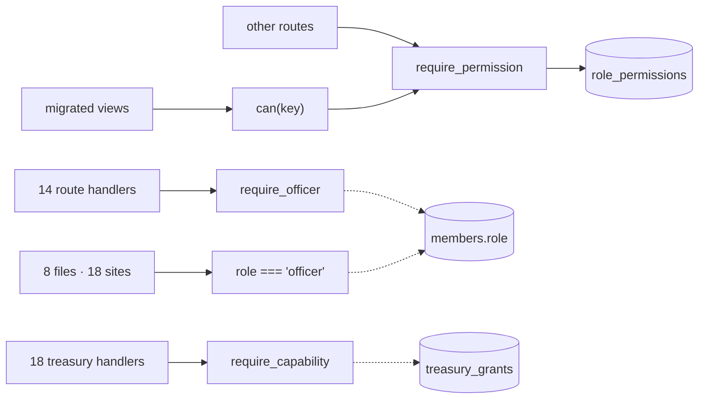
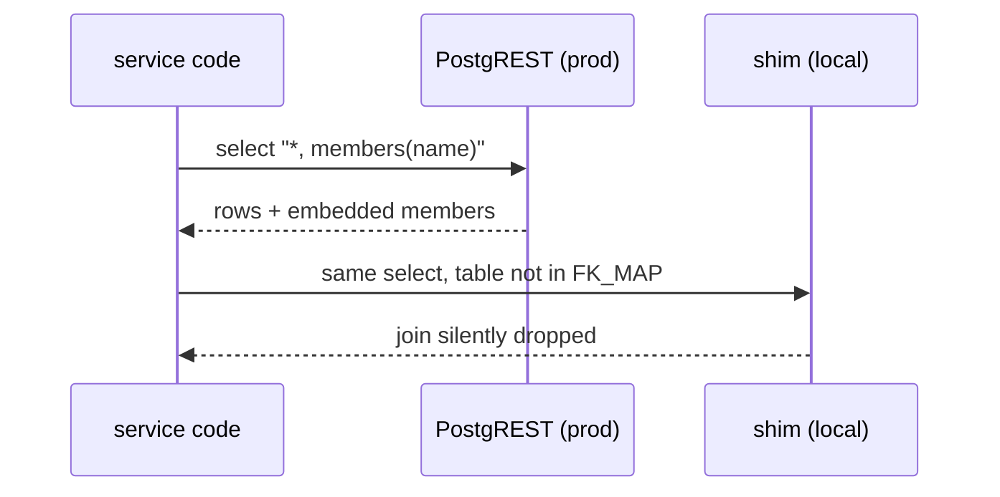
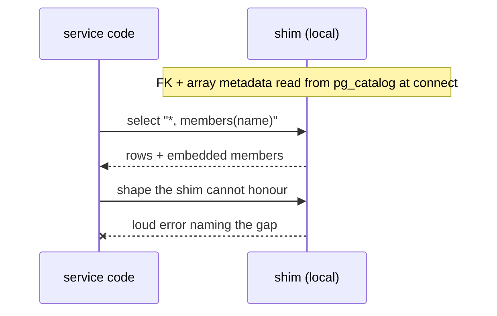

# Architecture review — GuildOS

2026-07-10 · backend `api/` 91 modules / 11.6k lines · frontend `fratos/` 89 files / 6.1k lines

Six deepening candidates (ranked Strong / Worth exploring), a dead-weight list of cheap deletions, and a top recommendation.

---

## 1. One gate for authority — finish the permission-key seam

**Strong · in-process · plan: `imp-one-gate.md` (2026-07-11)** — the open
treasury question below is resolved: fold into permission keys via stackable
roles (ADR-0003); also decided: everyone uses a password (officer-only
password rule deleted).

**Sites:**
- `api/dependencies.py:48` (`require_officer` → 14 call sites) · `api/auth/api/auth.py:47,62,96` · `api/attendance/api/excuses.py:72` · `api/treasury/api/fines_legacy.py:82` · `api/announcements/services/sms.py:116`
- fratos: `app-shell.tsx:44` · `sidebar.tsx:48` · `page-header.tsx:17` · `config/navigation.ts:40` · `views/{dashboard,events,fines,members,standing}.tsx` — 18 sites / 8 files
- Deep modules that already exist: `api/rbac/auth.py` (`require_permission`) · `hooks/use-permissions.ts` (`can`)

**Before — three gates, two tiers:**



**After — one interface, two adapters:** every route handler goes through `Depends(require_permission)` and every view/nav item through `usePermissions().can()`; both adapters resolve against a single deep Permission module ("is this member allowed `domain:resource:action`?") that owns `role_permissions` ∪ legacy compat, ownership escalations, and makes an officer split a re-seed-only operation.

**Problem.** Authority is gated three ways — permission keys, a legacy `require_officer` role-string dependency, and 18 frontend `role === "officer"` compares — so the permission model is part of every caller's interface, and a unit test (`navigation.test.ts:34`) pins the legacy gate in place.

**Solution.** Route every check through the two deep modules that already exist — `require_permission` on the backend, `can()` on the frontend — seed keys for the officer-only surfaces, delete `require_officer` and the `OFFICER_ONLY` array.

- locality: authority resolves in one module
- leverage: officer split = re-seed, zero view edits
- 32 role-string sites deleted
- ADR-0001 violations reach zero

> Aligns with ADR-0001 — these checks are defects by its own definition. Open design question for the grilling: treasury's `require_capability` (a second mechanism over `treasury_grants`, 18 call sites) — fold into permission keys, or record it as a deliberate second adapter?

---

## 2. Money speaks one unit — cents behind adapters

**Strong · in-process · ✅ resolved 2026-07-11**

**Sites:** *(new)* `lib/contracts/fines.ts` · `lib/adapters/fines.ts` · `lib/adapters/events.ts` — *(changed)* `api/treasury/api/fines_legacy.py` (`list_fines`) · `views/fines.tsx` · `views/dashboard.tsx` · `my-fines-widget.tsx` · `event-row.tsx:24` · `event-detail.tsx:82` · `treasury-dashboard.tsx:352-359` · `lib/adapters/treasury.ts` · `lib/types.ts` (`Fine` deleted)

**Correction to the original review.** The headline "live 100× display bug" was misdiagnosed on two counts:

- **Fines rendered `$NaN`, not 100× off.** The backend migrated `fines` → `unpaid_invoices`, renaming `amount` → `amount_cents` (plus `reason`→`description`, status `waived`→`cancelled`, and dropping the `members`/`events` joins). `GET /api/fines` returned those rows raw (`.select("*")`), so the frontend's `f.amount` was `undefined` — the fines list, My-Fines widget, and dashboard total showed `$NaN`/`$undefined`, and officer view showed blank names/reasons. No test pinned the list response shape, so the drift was invisible.
- **`standing.tsx:71` was never a bug.** It reads the *legacy* `fines` table (`NUMERIC(10,2)` dollars) via `engagement.py`, so `${m.unpaid_amount}` prints dollars-as-dollars — unit-correct. Converting it to cents would have *introduced* a 100× error. Left untouched.

**Before — the fines DTO had drifted out from under the frontend `Fine` contract:**

| Field | Path | Result |
|---|---|---|
| `Fine.amount` | field no longer exists in the response (it's `amount_cents`) | ✗ `$NaN` / `$undefined` in every fines view |
| `Fine.reason` / `.members` / `.events` | joins dropped in the invoices migration | ✗ blank reasons, member names, event titles |
| `Event.fine_amount` (float $) | ×100 inline, ×2 copied conversions → `formatMoney(…)` | fragile duplication |
| `TreasurySubmission` | two divergent mappers | pending tab formatting ≠ other tabs |

**After — one path, unit owned once:** DTO → adapter (owns the unit) → contract carrying `amountCents` → `formatMoney` → screen. Money in a contract is always integer cents; `formatMoney` is the only exit.

**What was done (2026-07-11).**
- Backend `list_fines` now presents a clean shape — integer `amount_cents`, `reason`/`issued_at`, and member/event names **stitched in Python** (the local shim has no `unpaid_invoices` FK registered, so a PostgREST embed would silently drop the join locally — see candidate 4). Two integration tests now pin the list contract + member scoping.
- New `lib/contracts/fines.ts` (`Fine` carrying `amountCents`) + `lib/adapters/fines.ts` (`adaptFine`/`adaptFines`, maps the invoice status enum onto the three UI states); both fines views load through the adapter. The raw `${f.amount}` in `my-fines-widget` is gone.
- New `lib/adapters/events.ts` `eventFineAmountCents()` — the single float-dollars→cents boundary, replacing the duplicated inline `Math.round(×100)` in `event-row`/`event-detail`.
- Treasury's divergent inline submission mapper replaced with the now-exported `adaptSubmission`; all tabs format identically.
- Stale `Fine` interface deleted from `lib/types.ts`.

- a whole feature that rendered `$NaN` is restored
- locality: unit conversion in adapters only
- contracts carry the unit; callers learn one rule
- treasury's divergent mappers become one

**Discovered here, not yet addressed (new follow-ups):**
- **Standing reads a frozen table.** `engagement.py` computes `unpaid_amount` from the legacy `fines` table, which the invoices migration froze (§7.8) — so standing likely shows $0 owed even when a member has invoice-based fines. A correctness bug, not a unit bug.
- **Dead fine-summary path.** `getFineSummary` (`lib/api-client.ts`) has zero callers and its `FineSummary` type (`lib/types.ts`) is itself stale (`total_unpaid` vs the backend's `total_unpaid_cents`). Cheap deletion — add to Dead weight.

> This was the frontend half of the backend's hard rule "money is always integer cents" — the rule now reaches the screen. The events-adapter conversion promised in `imp-fe-remediation` Phase B is done for the fine-amount display; a full `Event`→contract migration remains part of candidate 6.

---

## 3. Delete the plumbing shells — one platform module for db access

**Strong · in-process · plan: `imp-platform-module.md` (2026-07-11)** — now
also executes ADR-0002's deletions (supabase-py branch, `use_local_db`,
honest renames), which that ADR explicitly deferred to this consolidation.

**Sites:** `api/*/db/session.py` ×8 + 4 inlined `get_*_db()` · `api/*/db/rpc.py` ×6 (byte-identical `call_rpc`) · `api/*/auth.py` re-export shells ×9 · `api/standing/` (8-line facade → memberadmin) · `_row` idiom ×5 · `_delivery_mode()` ×3 · 12 include-only `router.py` wrappers

**Before — ~30 pass-throughs, one line of forwarding each:** `get_*_db() → get_supabase_admin()` ×12 · `call_rpc` copies ×6 · `auth.py` re-export shells ×9 · standing facade ×1. Deletion test: remove any of them and complexity vanishes — nothing was hidden. Standing hop chain today: 8 hops across 3 packages.

**After — one deep module, thin callers:** all 17 domains import a shared platform db module that owns client acquisition (one pool, one accessor), `call_rpc` + the array-param registry, row unwrap (`_row`), and delivery mode. Per-domain files remain only where behaviour differs: events/initiatives auth rules, treasury notifications.

**Problem.** ~30 modules whose implementation is one line of forwarding — every reader hops through them, every new domain copies them, and "where does this domain get its client" has two answers depending on domain age.

**Solution.** One shared platform module owns client acquisition, `call_rpc`, and row-unwrapping; domains import it; `standing/` folds into `memberadmin/`; per-domain files survive only where behaviour genuinely differs.

- ~30 pass-throughs deleted (~250 lines)
- locality: rpc behaviour has one home
- array-typed RPC registration: one obvious place
- standing hop chain 8 → 4

> CLAUDE.md's canonical domain layout mandates these files per domain — the layout doc would be amended, not violated silently. The per-domain seam was hypothetical: one adapter behind all 12 accessors, and tests inject `sb` directly anyway.

---

## 4. Make the local-Postgres adapter honest

**Worth exploring · ports & adapters · plan: `imp-db-introspection.md`
(2026-07-11)** — premise updated by ADR-0002 (decided a day after this
review): there is no PostgREST adapter anymore; this psycopg client serves
production. The two-adapter divergence framing below is obsolete, but the
hand registries and the silent join drop are now *production* footguns, so
the solution (introspect `pg_catalog`, fail loudly) stands, decided
2026-07-11.

**Sites:** `api/postgres_client.py:25-32` (`FK_MAP` — 6 tables) · `:36-52` (`JOIN_STAR_COLUMNS` — 3 tables) · `:191-201` (silent join drop / runtime ValueError) · `:469-488` (`_ARRAY_TYPED_RPC_PARAMS` — 1 entry, 40-line apology comment)

**Before — two adapters, silent divergence:**



**After — converge, or fail loudly at the seam:**



**Problem.** The db seam is real — two adapters, PostgREST in prod and the 580-line shim locally — but the shim's interface secretly includes three hand-maintained registries: unregistered joins are dropped without error, `related(*)` works on 3 tables and raises on the rest, and every new array-typed RPC param fails locally until someone edits `_ARRAY_TYPED_RPC_PARAMS`.

**Solution.** Derive FK and array-type metadata from the pg catalogs at connect time, and make any select the shim can't honour raise at the call site — the adapters converge, or the divergence becomes visible instead of silent.

- "works locally, fails on Supabase" bug class dies
- registries leave every RPC author's interface
- seam gains depth: callers stop memorising limits

---

## 5. Give mutations a seam

**Worth exploring · local-substitutable · plan: `imp-mutation-seam.md` (2026-07-11)**

**Sites:** `hooks/use-api.ts` (reads only, deep) · try/catch + `setActionError` copies ×6: `views/{tasks,announcements,recruitment,bylaws,command,admin-roles}.tsx` · direct singleton calls: `excuse-form.tsx:26` · `check-in-form` · `create-event-form` · `pending-excuses-widget.tsx:41` · `lib/api-client.ts:431` (singleton export)

**Before — the same three bands, copied six times:** each of tasks / announcements / recruitment / bylaws / command / admin-roles re-implements saving/error state + try/catch + a call to the module-global api singleton. Forms call the singleton directly — untestable through their interface without patching a global.

**After — one hook, injectable client:** a `useMutation(fn)` hook owns saving · error · success · reload hook-in, crossing one seam: the api client provided via context — `ApiClient` in prod, fake adapter in vitest. Two adapters make the seam real; components shrink to markup + one hook call.

**Problem.** Reads have a deep hook (`useApi`); mutations don't — six components re-implement saving/error state around identical try/catch blocks, and forms call the api singleton directly, so nothing below the e2e suite can test them.

**Solution.** A `useMutation`-shaped hook owns the mutation lifecycle, and the api client is provided through context so a fake adapter can sit at the seam in vitest.

- 6 duplicated try/catch blocks collapse
- forms testable through their interface
- loading/error markup converges on primitives

---

## 6. Collapse the events relay

**Worth exploring · in-process · plan: `imp-events-module.md` (2026-07-11)**

**Sites:** `views/events.tsx` (237 L: 4 useEffects, 5 mutation handlers, 9 state cells) · `components/modules/events/event-detail.tsx` (27-prop interface, pure forwarding) · `attendance-roster.tsx` · `attendance-row.tsx` · `manual-attendance-modal.tsx`

**Before — markup moved, behaviour didn't:**

```
views/events.tsx — all state, all handlers, polling
└─ EventDetail — 27 props in, 27 forwarded, zero behaviour   ← leak
   └─ AttendanceRoster — forwards onSetStatus
      └─ AttendanceRow — the button
         └─ ManualAttendanceModal — the form
```

"Set attendance status" = 6 files; deletion test on the relay passes — inline it and nothing is lost.

**After — the module owns the workflow:** `EventsPage` becomes thin (picks an event, interface = event id + a couple of slots); the events module owns a workflow hook (polling · attendance · check-in links) with detail / roster / row / modal internal. After the deepening, deleting the module would lose real behaviour — it earns its keep.

**Problem.** The events extraction split by markup, not behaviour — the page kept every handler and effect, and `EventDetail`'s interface is 27 props it merely forwards, the widest interface in the frontend with zero behaviour behind it.

**Solution.** Move workflow state and handlers into the events module (a workflow hook or composition at the detail level); the page shrinks to selection, the relay's interface shrinks from 27 props to a handful.

- locality: events behaviour lives in the module
- hop chain 6 → 3
- 27-prop interface becomes a handful

---

## Dead weight (cheap deletions — no design needed)

*Plan: `imp-hygiene.md` (2026-07-11); the standing follow-up from candidate 2
has its own plan, `imp-standing-fines.md`. Execution order decided
2026-07-11: hygiene → standing fix → platform module (3) → one gate (1) →
introspecting client (4) → mutation seam (5) → events module (6).*

Not deepening candidates; each failed the deletion test in the trivial direction. They cost navigation time — an explorer hunted for several of these before finding they don't exist or aren't used.

- `api/routes/` · `api/services/` · `api/models/schemas.py` — already dead (zero imports), but CLAUDE.md and two CONFORM_TODO.md files still describe them as live. Update the docs; the "legacy flat modules" era is over.
- `components/ui/data-table.tsx` — 74 lines, zero importers; treasury hand-rolled its own table instead.
- `api-client.getFineSummary` + `lib/types.ts FineSummary` — zero callers, and the type is stale anyway (`total_unpaid` vs the backend's `total_unpaid_cents`). Surfaced while fixing candidate 2 (2026-07-11).
- `mocks/data/treasury.ts` — the conventions' mock-api layer was never built; this file is imported by nothing.
- `NEXT_PUBLIC_ENABLE_VP_MODULE` / `_SECRETARY_MODULE` — env flags with zero references in source.
- `app/treasury-preview/` — empty directory · `events/api/schemas.py EventResponse` — self-described orphan.
- `Prod/fratos` — a pre-refactor fossil (34 files vs 89, months behind); consolidation is already a known open task, noted here only because it doubles every grep.
- `e2e/fines.spec.ts:30` — "member can pay a fine" test for a pay path that has no endpoint and no button; it cannot be exercising what its name claims.

---

## Top recommendation

**One gate for authority — finish the permission-key seam** (candidate 1).

The decision is already made (ADR-0001), both deep modules already exist on both tiers, so the work is routing 32 call sites through them and seeding keys — near-zero design risk, and it unblocks the planned per-office split of Officer authority that motivated the ADR. Do it before more views copy the role-string pattern; a unit test is already pinning the defect in place.

Independent of any choice here: candidate 2's suspected money bug was **confirmed, diagnosed, and fixed (2026-07-11)** — but the diagnosis changed. It was a DTO-contract drift that rendered the whole fines feature `$NaN` (not a 100× error), and `standing.tsx:71` turned out to be unit-correct dollars, not a bug. See candidate 2 for the corrected write-up and two follow-ups it surfaced.
